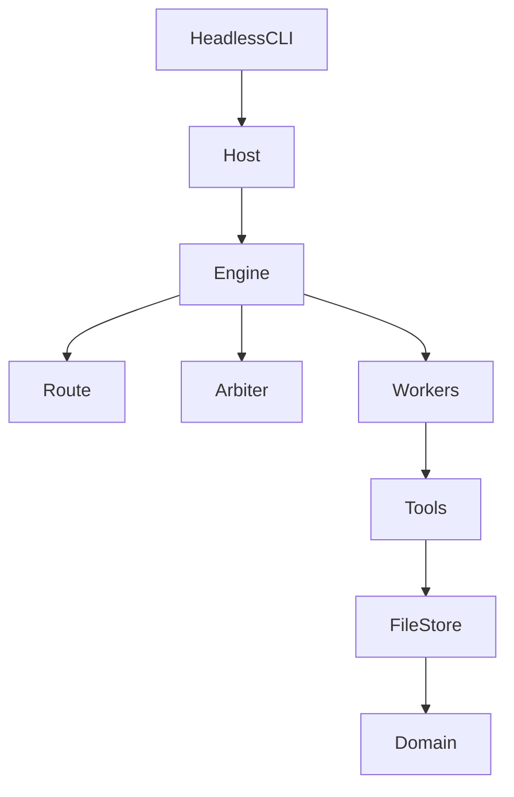

# 架构与铁律

目标按这个优先级排：先能稳定写完一本书，再让文风和评审可以单独改，然后保证崩溃能续上，最后才是每一步可观察。稳定是前提。每个决定先服务稳定。

## 三分法

决策按性质归位，不发明第四种模式。

- 能穷举的状态迁移交给代码。写完一章后派谁，是读事实查表。`Route` 是纯函数，组合用测试钉死，零模型开销。
- 边界清楚的语义判断交给裁定函数。选规划师、用户插话怎么处理、失败或僵局往哪走：事实进去，结构化决定出来，机械校验兜底，每次裁定落盘，可以离线重放。
- 开放式创作交给自主循环。一章、一次评审、一次规划之内，规划师、写作者、审阅者各自判断。

```text
确定性平面:  LoadState → Route → Instruction
语义平面:    Collect → Decide → Decision → 引擎执行
创作平面:    Worker 循环 → 工具 → 文件事实
```

以后新增决策点先过这三问。能查表的进 `Route`，边界清楚的进裁定，开放的进创作代理。三者都不是的，先重新想它是不是真的存在。

## 分层

```text
entry/          无界面入口，后置终端界面。只展示和接收输入
host/           生命周期、引擎循环、干预编排、预算、章节推进门
flow/           LoadState（读盘）与 Route（纯函数）
arbiter/        四个裁定场景
agents/         三个创作代理的装配、提示词、停止条件
llm/            LiteLLM 适配、流式、重试、角色模型。不含小说业务
tools/          事实层唯一写入口
store/          文件系统
domain/         纯数据与迁移规则，无 IO
```

依赖单向：`entry → host → agents / arbiter → tools → store → domain`。`flow` 在 `store` 之上、`host` 之下。`Route` 禁止读盘。观察、诊断、日志只读事件和工件，不产生事实，不改控制流。



包目录约定（实现阶段再建，本步不建空包）：

```text
ainovel/
  domain/ store/ flow/ tools/ arbiter/ agents/ host/ entry/ llm/
  assets/prompts/ assets/references/ assets/styles/ assets/voice.md
  web/      独立前端，开发时单独打开，接口在 entry/web.py
```

## 四条铁律

1. 工具只返回事实，不返回跨调度指令。`commit_chapter` 可以返回 `arc_end`、`needs_expansion` 这类字段。下一步派谁只由 `Route` 或裁定决定。工具返回里的 `next_step` 只告诉当前代理“我刚做完这一步，下一步通常是什么”，不算调度。
2. 路由由 `Route` 承担，执行由引擎承担。引擎每轮重新读事实再查表，直接运行对应代理。返回空表示没有可由事实推出的创作任务：完本、等待干预，或规划期还没裁定。同一 `代理 + 任务` 连续出现说明后置条件没满足：第 3 次问裁定，第 5 次硬停并暂停。代理内部的 plan、draft 等中间检查点不把这个计数清零。
3. 语义裁定走裁定层，每次落盘。输出和一切模型输出一样不可信：先过 JSON 结构，再按事实做机械校验。
4. 代码只固化能证明的不变量：权限、阶段、顺序、幂等、结构完整。写什么、好不好、计划怎么迁就正文，留给创作代理或裁定。禁止用关键词、分数阈值或规则表代替模型理解。

## 事实只有三类

- **进度**：写到第几章、处于哪个阶段、待返工队列。
- **检查点**：某一步已经成功落盘。恢复和“做完了”的唯一证据。
- **工件**：正文、大纲、角色、摘要、裁定审计。

不引入任务队列、工作流实例、命令总线。需要持久化的附属事实（大纲反馈、裁定记录）也是扁平追加日志，各有唯一的写入者和读取者。能从章节记录重建的视图不另存一份。

## 三个创作代理

代理之间不直接通话。信息只经过文件里的工件。

| 角色 | 做什么 | 不做什么 |
|---|---|---|
| 规划师 `architect_short` / `architect_long` | 书名、简介、前提、大纲、角色、世界规则、展开下一弧、决定是否收束 | 写正文 |
| 写作者 `writer` | 一章的构思、正文、自查、提交；队列里的重写和打磨 | 改大纲结构 |
| 审阅者 `editor` | 结构与审美审阅，弧摘要、卷摘要 | 直接改正文 |

短篇规划师只用于 `planning_tier=short`。中篇和长篇用长篇规划师。级别一旦随设定落盘，补齐缺项时继续派同一个规划师，不再重新选择。

## 明确不做

违反下面任何一条，就是架构偏了。

1. 不在 `Route` 之外再做一个调度器。所有“下一步派谁”要么查表，要么走已落盘的裁定。
2. 引擎循环结束就是停。再跑起来只有用户继续，或进程重启后的恢复。不做空闲自动续跑。
3. 不把行为规训写进提示词来兜不变量。顺序和权限在工具前置条件里拦截。
4. 不根据“工具调用结束”推断任务完成。完成的证据是检查点写入。
5. 不并行跑多个创作代理。一本书一个串行循环。多本书用多进程。
6. 工具层不做模型调用。工具是校验、幂等和 IO。
7. 界面不直接读存储。只订阅宿主事件或读宿主快照。
8. 流程标签只由工具更新。`Route` 只读不写。
9. 诊断可以建议，不可以自己改文件、续跑或改流程。
10. 预算和逐章放行是引擎边界上的政策，不进 `Route`，也不进工具。
11. 改控制面先改穷举规格，再改实现。
12. 不做通用工作流语言、事件溯源或全局状态摘要。一张领域表就够了。
