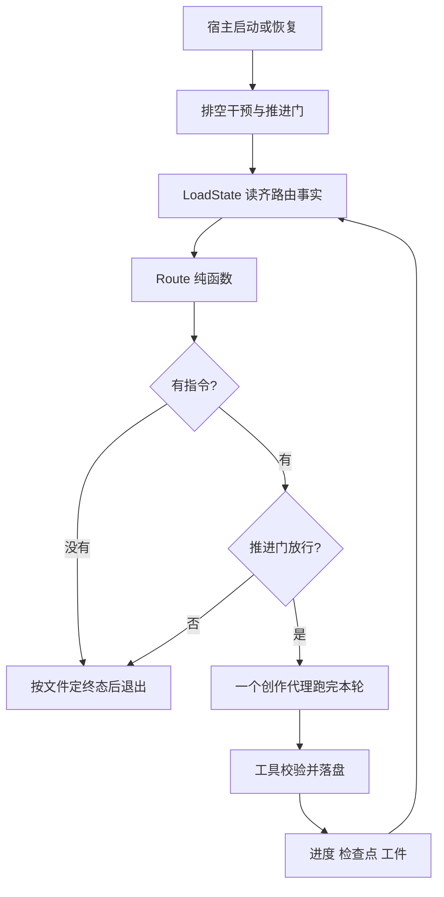
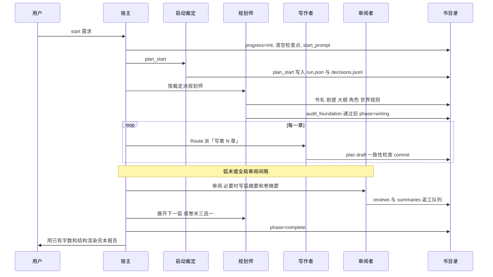

# Agent 系统设计

这份文档按「先看目标，再看闭环，再跟一本书怎么跑完」来读。它对照当前代码，用来理解本仓库的 agent 是怎么写成小说的。分册契约仍以 `.cursor/docs/` 为准；这里把它们收成一条能跟着走的主线。

代码入口从外到内是：

```text
entry/     命令行、写作控制室。只收输入、只展示快照
host/      一本书的租约、启动/恢复/干预、引擎
flow/      读盘装状态，纯函数决定下一步派谁
arbiter/   四类语义裁定：启动、干预、失败、僵局
agents/    三个创作代理的装配、工具循环、停止条件
llm/       LiteLLM 适配、重试、备用提供方。不含小说业务
tools/     书籍目录的唯一写入口
store/     文件系统
domain/    进度、检查点、阶段迁移。无 IO
```

依赖只朝一个方向：`entry → host → agents / arbiter → tools → store → domain`。`flow` 在存储之上、宿主之下。观察和诊断只读事件与文件，不产生事实，也不改控制流。

---

## 1. 业务目标层

目标按这个顺序排，后面的不能推翻前面的：

1. **先能稳定写完一本书。** 进程可以停、可以崩，已提交的章不重写，下次从最近落盘的事实继续。
2. **文风和评审可以单独改。** 写什么、好不好，留在模型和提示词里；顺序、权限、幂等留在代码里。
3. **崩溃能续上。** 恢复不靠模型对话，只靠进度、检查点和在途提交。
4. **每一步可观察。** 事件、快照、裁定审计、上下文占用。显示不参与调度。

所以这不是通用 agent 平台。它只服务一件事：从一句话需求，串行地规划、写章、审阅，直到完本或用户叫停。

业务上有三条硬边界：

| 边界 | 含义 |
|---|---|
| 一本书一个写进程 | 目录锁 `.ainovel.lock`。多本书用多进程，不在一本书里并行代理 |
| 循环结束就是停 | 不做空闲自动续跑。再跑只有用户继续，或进程重启后的恢复 |
| 已发生的正文是事实 | 大纲是计划。已写章节不被后来的规划改写 |

### 决策三分法

新增一个「下一步怎么走」时，先问它属于哪一层。三者都不是，就先怀疑这个决策点是否该存在。

| 平面 | 放什么 | 例子 | 代码 |
|---|---|---|---|
| 确定性 | 能穷举的状态迁移，零模型 | 写完一章后派谁 | `flow/route.py` 的 `route()` |
| 语义 | 边界清楚、要理解一句话的判断 | 选短篇还是长篇规划师；用户插话怎么处理 | `arbiter/decide.py` |
| 创作 | 开放写作，一章或一次规划之内自己判断 | 正文、大纲、审阅结论 | `agents/workers.py` + `agents/loop.py` |

```text
确定性平面:  LoadState → Route → Instruction
语义平面:    Collect → Decide → Decision → 引擎执行
创作平面:    Worker 循环 → 工具 → 文件事实
```

禁止用关键词、分数阈值或规则表代替模型理解「写得好不好」。代码只固化能证明的不变量：权限、阶段、顺序、幂等、结构完整。

### 事实只有三类

不引入任务队列、工作流实例或命令总线。

- **进度** `meta/progress.json`：阶段、流程、已完成章、待返工队列、字数、卷弧游标。
- **检查点** `meta/checkpoints.jsonl`：某一步已经成功落盘。恢复和「做完了」的唯一证据。
- **工件**：正文、大纲、角色、摘要、审阅、裁定审计。

能从章节记录重建的视图不另存一份。需要持久化的附属事实（大纲反馈、裁定记录）是扁平追加日志，各有唯一的写入者和读取者。

---

## 2. 核心闭环架构

引擎是单线程串行循环。每一轮重新读盘，再查表，再跑一个代理。代理之间不通话，信息只经过文件。



一轮内部的顺序在 `host/engine.py` 的 `Engine.run`：

```text
若界面请求让出 → 本轮结束后退出，不记成暂停
章节推进门处理边界（一次性暂停、核对放行许可）
指令 = 干预派单 或 Route(LoadState) 或 规划期补裁
指令为空 → 退出
前置检查（完本期丢掉派发；目标章还是骨架则改派规划师展开）
同一「代理 + 任务」的僵局计数
推进门是否放行这条指令
运行对应代理
成功则记下上下文占用；失败则再跑一次，仍失败则交裁定
```

`Route` 返回空，表示没有可由事实推出的创作任务：完本、等待干预、规划期还没裁定、或流程停在审阅/干预。宿主此时按文件定终态：阶段已是 `complete` 则渲染完本报告，否则空闲或已暂停。这里禁止再把自己启动一次。

### 指令长什么样

`flow/model.py` 里的 `Instruction` 只有四件事：

```text
agent    architect_short | architect_long | writer | editor
task     交给该代理的任务文本
reason   为什么是这一步，写入事件和失败裁定
chapter  写作者涉及的章节号；其他代理常为 0
```

路由输入必须在 `LoadState` 里列全。`Route` 禁止再读文件、禁止调用模型、禁止写进度。

### 路由命中顺序

互斥，从上到下第一条命中即返回。实现见 `flow/route.py`。

1. 没有进度，或阶段是 `complete`：空。
2. 还没进入 `writing`：设定有缺项且规划级别已落盘，派同一个规划师补齐。缺项只剩 `foundation_audit` 时，任务改为重读工件并调用 `audit_foundation`。级别还是空：空，交给引擎做启动补裁。
3. `pending_rewrites` 非空：派写作者处理队首。流程是 `polishing` 用「打磨」，否则用「重写」。
4. 流程是 `reviewing` 或 `steering`：空。审阅和干预不由查表抢跑。
5. 外部修订后要重建弧审阅、弧摘要、卷摘要或全局审阅：派审阅者。
6. 有必须马上处理的外部修订：派当前规划师，只处理这批反馈。
7. 分层书并且上一章是弧末，按缺口：弧审阅 → 弧摘要 →（卷末）卷摘要 → 下一弧仍是骨架则展开 → 需要新卷则规划师三选一。
8. 非分层书到达全局审阅间隔且这次还没有 `scope=global` 的审阅：派审阅者。
9. 非分层书下一章超出大纲总章数：派规划师决定完本，或续接大纲。禁止派写作者去写大纲里不存在的章。
10. 其他：派写作者写下一章。

阶段 `Phase` 只前进：`init → premise → outline → writing → complete`。离开完本不走这条规则，只能经存储层 `reopen`。流程 `FlowState` 在 `writing / reviewing / rewriting / polishing / steering` 之间按 `domain/transitions.py` 的表迁移。流程标签只由工具更新，`Route` 只读不写。

### 僵局和失败

引擎记下上一轮的 `agent + task`。查表仍得到同一键，计数加一。指令变了就清零。代理内部新的 plan、draft 检查点不算引擎级进展。

| 次数 | 动作 |
|---|---|
| 第 3 次 | `deadlock` 裁定。`retry` 不清零计数 |
| 第 5 次 | 硬停并暂停 |

失败分层：

- 超时、流中断：模型层在当前提供方重试，引擎看不到。
- 429 / 503：切到该角色的备用提供方。当前宿主装配只配了主模型，备用列表为空时这类错误会直接抛出。
- 鉴权失败、模型不存在、安全拒答：不重试，上抛。
- 流空闲：代理循环内最多 7 次。
- 未知代理、参数在代码层就不可能合法：引擎直接暂停。
- 其余代理错误：同一指令再跑一次。仍失败则 `worker_failure` 裁定，动作为 `retry`、`reroute` 或 `abort`。
- 裁定自己失败，或动作是 `abort`：暂停。

裁定产生的派单在执行前对账阶段、流程和返工队首。对不上就丢掉这条派单，把原始干预送回完整裁定路径。

### 恢复不恢复对话

继续和进程重启都是起一个新循环。没有会话要恢复。

1. 一致性告警（进度说第 N 章已完成，但正文缺失或为空）。告警不自动改文件。
2. 推进门对账。
3. 若 `pending_steer` 还在，先走干预裁定，再拉起引擎。
4. 否则引擎以空指令启动，完全由 `Route` 从文件重算。

重复派发是安全的：写工具按检查点幂等，未完成的提交按冻结的草稿续跑，不采用新的模型参数。

---

## 3. 小说生成完整流程

下面是从一句话到完本的主路径。括号里是落盘证据。



### 3.1 新建

`Host.start`：

1. 进度写成 `init`，检查点清空，需求写入 `meta/run.json` 的 `start_prompt`。
2. `plan_start` 裁定选出 `architect_short` 或 `architect_long`，并给出交给规划师的任务文本。需求少于 20 字时，任务里要补差异化方向、目标读者、核心消费点，以及至少一个非常规钩子。
3. 裁定写入 `plan_start`，并追加 `meta/decisions.jsonl`。`planning_tier` 落成 `short` 或 `long`。级别一旦落盘，补齐缺项时继续派同一个规划师，不再重新选择。
4. 引擎按这条指令启动。

裁定失败不是死局：需求已经在文件里。下次 `resume` 发现级别还空、设定仍缺，会现场补裁一次。补裁失败就暂停并说明，禁止静默停机。记录还在时，恢复不会重新问模型。

### 3.2 规划

短篇规划师一次写扁平大纲。长篇只做指南针、起步两卷骨架和第 1 弧的详细章节；后面的弧和卷写到边界再展开。

规划师必须把产出写进工具。对话里的 Markdown 或 JSON 不算完成。收尾工具成功后本轮结束，结束前必须出现本任务对应的新检查点。

设定齐全后还有一道审查：规划师重读 `novel_context`，把 `foundation_status.fingerprint` 原样传给 `audit_foundation`。指纹对得上且 `ready=true`，才把阶段改为 `writing`。有冲突则 `ready=false` 并给出 issues，不进入写作。

### 3.3 写一章

写作者的合法顺序由工具前置条件卡住，提示词只是提醒：

```text
novel_context
  → read_chapter（首章可缺，用来找回语气）
  → plan_chapter          drafts/NN.plan.json
  → draft_chapter         drafts/NN.draft.md   新章必须整章起草
  → check_consistency     只返回事实，不打分
  → commit_chapter        终稿 chapters/NN.md
```

返工队列里的旧章用 `edit_chapter` 代替整章初稿，检查和提交仍然要发生。`commit_chapter` 成功即停。`isolate_stop` 要求结束工具单独一轮调用：同一轮里若还夹着别的工具，结束工具会被退回，先读完其他结果。

`check_consistency` 交还：计划里点名但草稿没出现的角色、本章之前仍未收的伏笔、近期时间线、世界规则、状态变化。改不改稿由模型判断。提交只要求这次检查的检查点对得上当前草稿。

### 3.4 提交 Saga

`commit_chapter` 是唯一跨多个文件的写操作。首次调用把规范化参数和草稿正文冻结进 `meta/pending_commit.json`。中断后续跑忽略新参数，从当前阶段往后做。

```text
started           冻结意图和正文快照
state_applied     正文写入 chapters/NN.md，并按章替换时间线、伏笔、关系、状态变化
progress_marked   更新已完成列表、字数、流程、卷弧游标；返工则移出队首
signal_saved      写检查点 commit、章摘要、meta/last_commit.json
清除 pending      返回事实：下一章、是否弧末、是否要展开、是否完本、机械违规
```

返回里的 `next_step` 只告诉当前代理「我刚做完这一步」。下一步派谁只由下一轮 `Route` 决定。空正文、或重复提交已稳定完成且摘要相同的章，按幂等返回，不制造第二份终稿。

### 3.5 审阅、展开、收束

分层书在弧末按缺口派发：

1. 审阅者 `save_review`，`scope=arc`。通过则流程回到 `writing`；需重写或打磨则相关章进入 `pending_rewrites`。
2. 审阅者 `save_arc_summary`：弧摘要、角色快照、这一弧之后要遵守的写作规则。
3. 卷末再 `save_volume_summary`。
4. 下一弧仍是骨架：长篇规划师 `expand_next_arc`。已写章节不动。
5. 需要新卷：规划师三选一，并在 `reason` 里写判定理由。
   - `append_volume`：故事继续
   - `append_volume` 且卷上 `"final": true`：收官卷，写完且弧审阅、弧摘要、卷摘要齐了就自动完本
   - `complete_book`：完结条件当下已经满足

`complete_book` 的机械条件在设定工具里：大纲内章节都已写完、返工队列为空、指南针没有未收束的长线。`estimated_scale` 是证据，不是否决权。高估的规模不能单独阻止完本。

非分层书不走卷弧。已完成章数到达全局审阅间隔时派 `scope=global`。大纲写完后派规划师决定完本或续接，不派写作者越界。

审阅者被派去写摘要时，只调用 `save_review` 不算完成；被派审阅时，只写摘要不算完成。护栏按本轮任务要求的检查点步骤名检查。

### 3.6 干预

用户插话与停机后的继续走同一条路径。`pending_steer` 先落盘，第一次写失败就停止，绝不在没有恢复记录时继续执行。

裁定动作可以组合，引擎执行顺序固定：`answer` → `rules` → `hold` → `reopen` → `dispatch`。至多一个 `dispatch`。

| 动作 | 何时用 |
|---|---|
| `answer` | 马上回显给用户 |
| `rules` | 长效写作要求，写入本书规则，之后由 `novel_context` 注入 |
| `hold` | 一次性暂停。只拦截「再写一个新章」 |
| `reopen` | 仅完本期。把指定章放回复工，完本期禁止直接派单 |
| `dispatch` | 派给某个代理的一条任务。阶段不匹配会在校验阶段拒绝 |

改篇幅和后续剧情走派给规划师的 `dispatch`。改旧章走审阅入队或 `reopen`。

### 3.7 逐章验收

这是引擎边界上的政策，不进 `Route`，也不进工具。`review on` 之后，每个正向新章要单独 `next` 放行。返工、审阅、结构维护、提交恢复都不消耗这张许可。许可绑定章节号：该章进入已完成列表、`pending_commit` 已清除、并且存在这次提交的检查点，才消费许可。`auto` 模式下如果还留着许可章号，视为损坏并暂停。

### 3.8 完本

阶段变为 `complete` 后，宿主用已有章数、字数、卷弧和未收伏笔渲染报告，不再调用模型。完本后再次运行不会自己续写。要改旧章，只能经干预重开。

### 3.9 导入已有文本

导入是另一条入口，不走上面的逐章写作循环。切分、分析和合成写在 `meta/import/`。发布是唯一写入 `chapters/` 的步骤。不加确认时停在切分，命令打印 `await_confirmation`。发布后默认停在边界，用 `resume` 才进入正常写作。

---

## 4. 多代理写作

这里的「多代理」是三个角色、一条串行循环，不是互相聊天的群体。每次运行是一次独立循环：独立上下文、独立停止条件。代理之间不共享对话。

| 角色 | 做什么 | 不做什么 | 轮数上限 | 结束工具 |
|---|---|---|---|---|
| `architect_short` | 短篇一次性规划 | 写正文 | 15 | 设定与大纲类收尾工具 |
| `architect_long` | 指南针、骨架、展开弧、卷末三选一 | 写正文 | 20 | 同上 |
| `writer` | 一章的构思、正文、自查、提交；队列里的重写和打磨 | 改大纲结构 | 30 | 仅 `commit_chapter` |
| `editor` | 结构与审美审阅，弧摘要、卷摘要 | 直接改正文 | 20 | `save_review` 或对应摘要工具 |

短篇规划师只用于 `planning_tier=short`。中篇和长篇用长篇规划师。

### 代理循环本身不认识小说

`agents/loop.py` 的 `run_agent` 只做四件事：调用补全、派发允许列表内的工具、写完即停、用检查点护栏判断能不能结束。停哪些工具、要求哪个检查点步骤，由 `workers.py` 传入。

一轮对话从两条消息开始：系统提示词、本轮任务。然后：

```text
补全
  安全拒答或内容过滤 → 本轮失败
  有工具调用 → 逐个执行，结果以 JSON 塞回 tool 消息
  命中结束工具且成功 → 再问护栏
  护栏拒绝 → 把拒绝原因作为 user 消息，再问模型
  连续拒绝达到 3 次 → CheckpointGuardError，交给引擎
  超过 max_turns（默认 32，各角色另有更小上限）→ 本轮失败
```

未知工具、参数不是对象、工具抛出的校验或冲突，都变成 `{"error": "..."}` 交回模型，不直接炸循环。工具必须返回对象。

### 检查点护栏

`CheckpointGuard` 以本轮开始时的最大检查点序号为界。结束前，要求的步骤里至少有一个序号比基线新，才允许停。中间出现更新的检查点会把连续拦截清零。因此「模型说我写完了」不算完成，完成的证据是检查点写入。

规划师要求的步骤名包括 `book`、`premise`、`outline`、`layered_outline`、`characters`、`world_rules`、`foundation_audit`、`expand_next_arc`、`append_volume`、`update_compass`、`complete_book`、`resolve_outline_feedback`。写作者只要求 `commit`。路由派发带职责码，审阅者按职责码选择 `review`、`arc_summary` 或 `volume_summary`。裁定写成的自由任务没有职责码，才从任务文本识别。

### 提示词怎么装

资产在 `src/ainovel/assets/`：

```text
prompts/     architect-short.md  architect-long.md  writer.md  editor.md
             arbiter-plan-start.md  arbiter-intervention.md  arbiter-failure.md
voice.md
styles/      default fantasy romance suspense history scifi urban wuxia xianxia
references/  章节模板、一致性、去 AI 腔、体裁弧线
```

写作者的系统提示词分成协议和文风。`writer.md` 保留执行顺序、断点续跑、重写与打磨、章节契约，中间用 `{{VOICE}}` 占位。组装函数把文风填回去，再接上风格预设。生产、评测、测试走同一个函数，所以改文风不会改状态机。

覆盖从低到高：包内 `ainovel/assets/`，然后 `~/.ainovel/style/`，然后本书 `<书目录>/style/`。同名风格整文件替换。用户规则来自干预裁定，运行时由 `novel_context` 注入，优先级最高。需要机械保证的禁用词、疲劳词、字数走规则层，在提交时检查，出现在 `rule_violations` 里。

每个 `Worker` 会按「书目录哈希 + 角色名 + 运行序号」算一个 `prompt_cache_key`。当前补全路径还没有把这个键发给模型；它是为前缀缓存准备的装配字段。

---

## 5. 工具系统设计

工具是创作代理和书目录之间的唯一出入口。代理不直接读写文件。工具层不做模型调用。工具是校验、幂等和 IO。

登记表在 `tools/__init__.py` 的 `TOOLS`。每个代理只能看到 `agents/catalog.py` 里自己的那一份说明和参数模式。多出来的名字不会放进该代理。循环里工具按名字排序后再交给模型，避免参数模式的键序把请求前缀打乱。

### 契约

- 返回值是事实 JSON。可以带 `next_step`，告诉当前代理下一步通常调用哪个工具。
- 禁止返回「去叫另一个代理」。
- 写工具单文件原子。成功后追加检查点。已有相同 `scope + step + digest` 时直接返回已有产物。
- 所有写工具禁止并发。一本书本来就只有一个写进程。

### 读工具

任何时候可调用，不改文件，不写检查点。

| 工具 | 作用 |
|---|---|
| `novel_context` | 按范围装入足够独立决策的事实。见下一节记忆 |
| `read_chapter` | 读已提交的 `chapters/NN.md`。章不存在则冲突 |

### 写工具按角色

规划师：`save_book`、`save_foundation`、`audit_foundation`、`expand_next_arc`、`revise_outline`、`resolve_outline_feedback`。

`save_foundation` 的 `type` 是封闭枚举：`premise`、`outline`、`layered_outline`、`characters`、`world_rules`、`append_volume`、`update_compass`、`complete_book`。`scale` 只允许 `short` / `mid` / `long`，写入规划级别。

写作者：`plan_chapter`、`draft_chapter`、`edit_chapter`、`check_consistency`、`commit_chapter`。

没计划不能起草，没草稿不能做一致性检查，没草稿不能提交，不在返工队列队首不能定点改。

审阅者：`save_review`、`save_arc_summary`、`save_volume_summary`。

工具不替模型打分。它校验审阅事实，再把结论映射成流程和返工队列：通过回到 `writing`；需重写进入 `rewriting`；需打磨进入 `polishing`。弧级审阅的 `issues[].chapters` 必须落在该弧章节区间内。弧摘要在弧审阅完成前拒绝；卷摘要在卷末弧摘要完成前拒绝。

### 错误交给谁

| 情况 | 谁处理 |
|---|---|
| 参数非法 | 工具抛校验错误，代理改参数 |
| 缺前置、阶段冲突、在途提交章节不符 | 工具抛冲突，代理先读 `novel_context` |
| 网络超时、流中断、429、503、鉴权 | 模型适配，见下一节 |
| 流空闲过久 | 代理循环，最多 7 次 |
| 代理失败且不是确定性代码错误 | 引擎再跑一次，仍失败则裁定 |
| 同一指令反复无进展 | 第 3 次问裁定，第 5 次熔断 |

---

## 6. 模型层设计

`llm/` 不含小说业务。业务代码不直接调用 LiteLLM。

```text
Worker / Arbiter
    → RoleClient          重试与备用提供方
        → LiteLLMTransport  流式补全、空闲超时、异常分类
            → litellm.completion
```

宿主 `completer_from_config` 用 `~/.ainovel/config.json` 里的 `provider`、`model`、`api_key`、`api_base` 装一个主模型。规划、写作、审阅和裁定共用这份默认模型。传给 LiteLLM 的名字是 `provider/model`；`model` 本身已带 `/` 时原样使用。

`RoleModel` 结构上可以带 `fallbacks`。当前这条装配路径只填了主模型。

### 一次补全

`LiteLLMTransport.complete` 始终 `stream=True`。流在空闲超过约 120 秒时中断。块聚合成 `Completion`：正文、工具调用、停止原因。若宿主挂了 `on_delta`，流式正文可以边到边送出；成功生成的正文留在书目录里，不把全文再抄进运行日志。

异常先收成稳定种类（`llm/classify.py`）：

| 种类 | RoleClient |
|---|---|
| `timeout`、`stream_interrupted` | 当前提供方重试，默认最多 3 次，退避 0.5s、1s |
| `rate_limit`、`unavailable` | 切到下一个备用。没有备用则上抛 |
| `auth`、`model_not_found`、`unknown`、`stream_idle` | 立即上抛 |

代理循环只对 `stream_idle` 做循环内重试。其他 `ProviderError` 直接离开本轮。

### 两类模型用法

**创作代理**是多轮工具循环。系统提示词和工具模式在前，任务和工具结果往后追加。动态指令放在尾部。

**裁定**是单次结构化调用，不写正文，不执行动作。`arbiter/decide.py` 把事实 JSON 交给模型，输出先抽 JSON 对象，再按场景做机械校验。结构或业务校验失败时，把精确原因送回模型修正，最多 4 次。拒答、截断、不可重试的请求错误立刻返回。收集事实的函数可以读盘；做决定的函数除了这一次请求外不读盘，以便用 `decisions.jsonl` 离线重放。

四个场景各有自己的决定类型，一个场景里表达不了另一个场景的动作：

| 场景 | 决定 |
|---|---|
| `plan_start` | `planner` + `task` + `reason` |
| `intervention` | `answer` / `rules` / `hold` / `reopen` / `dispatch` |
| `worker_failure` | `retry` / `reroute` / `abort` |
| `deadlock` | 与失败共用一种决定 |

恢复不看 `decisions.jsonl`。那是审计。恢复只看进度、检查点和 `run.json`。

### 写作者外面多包一层

只有写作者的补全器会被 `WriterContext` 包住。每次 `complete` 之前先按字符数看窗口，超了就压缩，再把占用写成「百分比 · 正常/警告/危险」交给引擎。占用只显示，不参与派谁。默认预算是 120_000 字符。中文按字符数估算，不用「字节除以 4」。

---

## 7. 记忆系统设计

记忆不在模型对话里。对话可以整段丢掉。长期记忆是书目录里的工件，每次任务用 `novel_context` 按策略重新装入。

有两层，不要混：

| 层 | 记住什么 | 何时更新 | 谁读取 |
|---|---|---|---|
| 文件记忆 | 章摘要、弧摘要、卷摘要、角色快照、伏笔、时间线、关系、状态变化、大纲、指南针 | 工具落盘时 | 下一轮 `novel_context`，以及压缩时的文件替换 |
| 对话记忆 | 本轮系统提示、任务、工具来回 | 只活在这一次 `run_agent` | 压缩器；进程重启后不恢复 |

### 按规模收缩窗口

`domain/context.py` 的 `context_profile` 只由章节规模推导，不落盘。

| 总章数 | 摘要窗口 | 时间线窗口 | 分层摘要 |
|---|---|---|---|
| ≤ 15 | 最近 10 章 | 最近 10 条 | 否 |
| ≤ 50 | 最近 5 章 | 最近 8 条 | 否 |
| > 50 | 最近 3 章 | 最近 5 条 | 是：卷摘要 + 本卷已完成弧摘要 + 最近章摘要 |

总章数大于 30 时，相关历史章从四个维度反查：未收伏笔、角色出场、状态变化、人物关系。反查只给章节号和理由，正文由写作者按需 `read_chapter`。另外附带下一章大纲，用来设计章末钩子，不把下一章写成这一章。

规划师不带章节号调用时，拿到设定缺项、指纹、用户规则、大纲反馈。带 `volume` + `arc` 时精确读取那一弧：已展开的弧返回章节，未展开的弧只返回目标。长篇规划读的是指南针和骨架，不是全书正文。

### 对话超窗时怎么压

`contextpack.py` 代价从低到高，每一步之后都重新放回当前章计划和角色快照，避免压缩后失忆：

```text
字符数未超预算 → 原样
否则丢掉除最近两条以外的工具结果，长文本截到约 800 字并保留头尾
仍超 → 用文件里已有的最近章摘要、角色快照、伏笔台账替换中间消息（不调用模型）
仍超 → 最后才让模型写叙事摘要，必须保留角色状态、未收伏笔、审稿待修、文风锚点
模型摘要失败 → 跳过并写明告警，下一轮再试
```

压缩替换的是中间消息，系统提示词留在头部。这是一次明确的整段失效，不是悄悄改写早期消息。

### 提交时写下的情节记忆

`commit_chapter` 在 `state_applied` 按章替换四本台账，同一章重放或返工只保留这一次的行：

```text
timeline.jsonl
meta/foreshadow.jsonl
meta/relations.jsonl
meta/state_changes.jsonl
summaries/NN.json          本章摘要
```

弧摘要 `summaries/arc-vVVaAA.json` 和卷摘要 `summaries/vol-vVV.json` 由审阅者在边界写入。它们是中距离和远距离记忆，不是另一套状态机。

---

## 8. 质量、监控与可观测

质量分三层。代码负责能核对的事实，模型负责好不好。

### 机械质量

| 机制 | 做什么 | 不做什么 |
|---|---|---|
| 工具前置条件 | 没计划不能起草，没检查不能提交 | 不评价文笔 |
| `check_consistency` | 交还缺席角色、未收伏笔、时间线、规则、状态 | 不打分，也不因此拒绝提交 |
| `rules.py` | 禁用词、疲劳词、字数等，提交结果里带 `rule_violations` | 不改写正文 |
| `audit_foundation` | 设定指纹一致才进入写作 | 不替规划师发明设定 |
| `complete_book` | 章节写完、返工清空、长线归零 | 不做文学评估 |
| 检查点护栏 | 没有新检查点不能结束本轮 | 不判断内容对不对 |

### 模型质量

审阅者从设定一致、角色行为、节奏、叙事连贯、伏笔、钩子、审美几方面阅读原文。审美再看描写质感、叙事手法、对话区分度、用词、情感打动力。结论必须引用原文。工具只把 `verdict` 映射成通过、重写或打磨。

文风统计 `stylestats.py` 由代码计数：满 5 章后统计明喻、沉默节拍、思维标记、高频短语、跨章重复句、章末形态。`novel_context` 把统计注入写作者和审阅者。好不好仍由模型判断。索引与提交共享同一进程内对象；进程重启后按已完成章重建。

### 可观测：看什么、不看什么

界面和日志是宿主事件的投影。界面不直接读存储，只订阅事件或读 `host/snapshot.py` 的快照。

快照里和写作控制有关的字段：

```text
phase  flow  current_chapter  next_chapter
completed_chapters  total_chapters  total_word_count
pending_rewrites
latest_instruction     最近一条任务和原因
running  paused  pause_reason
advance_mode  advance_permit_chapter  advance_hold
pending_steer
context_usage          写作者窗口占用，例如「72% · 警告」
events                 引擎发出的短事件
report                 仅完本期，由文件渲染
```

低于 70% 为正常，70% 到 85% 为警告，高于 85% 为危险。这三档不触发调度。

事件例子：启动裁定已补齐、同一指令将再跑一次、代理失败原因、推进模式切换、逐章验收等待放行、暂停原因。错误的完整文本进日志；界面只显示短摘要。

`meta/decisions.jsonl` 追加每次裁定的场景、输入事实、决定或错误。用它回放「当时为什么派了这个人」，不用它恢复进度。

`diag` 只读检查缺章和规则问题，并输出检查点骨架。诊断可以建议，不可以自己改文件、续跑或改流程。

规格里写过「预算在每轮边界检查，超预算暂停」。当前引擎没有代币预算熔断，只有写作者的上下文字符预算和占用显示。

### 你要追一次失败时

按这个顺序看，不要先翻模型对话（对话本来就不会留下）：

1. 宿主快照：阶段、流程、是否暂停、暂停原因、最近指令。
2. `meta/progress.json`：下一章、返工队列。
3. `meta/checkpoints.jsonl`：本轮要求的步骤有没有新序号。
4. `meta/pending_commit.json`：提交停在 `started`、`state_applied`、`progress_marked` 还是 `signal_saved`。
5. `meta/decisions.jsonl` 末尾：是启动、干预、失败还是僵局，动作是重试、改派还是中止。
6. 对应工件：`drafts/`、`chapters/`、`reviews/`、`summaries/`。

---

## 9. 和通用 Agent 框架的差别

读代码时用这张表对齐预期。

| 常见框架 | 本项目 |
|---|---|
| 规划器随时改图 | 下一步只由 `Route` 或已落盘的裁定决定 |
| 代理互相发消息 | 代理只通过文件工件协作 |
| 工具返回里夹带下一步代理 | 工具只返回事实和 `next_step` 工具名 |
| 模型说完成就算完成 | 完成等于检查点 |
| 崩溃后续聊 | 崩溃后续文件，对话不恢复 |
| 多代理并行 | 一本书一条串行循环 |
| 用分数阈值决定返工 | 审阅结论由模型给出，工具只做结构映射 |
| 把全文放进窗口 | 近处章摘要，中距离弧摘要，远处卷摘要 |
| 观察系统改控制流 | 事件、快照、占用只显示 |

---

## 10. 代码地图

想改某一层时，先打开这些文件。

| 你想看 | 文件 |
|---|---|
| 引擎一轮 | `src/ainovel/host/engine.py` |
| 启动、恢复、干预 | `src/ainovel/host/host.py` |
| 逐章放行 | `src/ainovel/host/gate.py` |
| 快照与完本报告 | `src/ainovel/host/snapshot.py`、`host/report.py` |
| 路由 | `src/ainovel/flow/route.py`、`flow/load.py` |
| 裁定与校验 | `src/ainovel/arbiter/decide.py`、`arbiter/validate.py` |
| 代理装配与循环 | `src/ainovel/agents/workers.py`、`agents/loop.py`、`agents/guard.py`、`agents/catalog.py` |
| 工具实现 | `src/ainovel/tools/` |
| 上下文压缩与窗口策略 | `src/ainovel/contextpack.py`、`domain/context.py` |
| 模型重试 | `src/ainovel/llm/policy.py`、`llm/litellm_client.py`、`llm/classify.py` |
| 在途提交 | `src/ainovel/domain/commit.py`、`tools/writing.py` |
| 阶段与流程迁移 | `src/ainovel/domain/transitions.py` |
| 文风统计与规则 | `src/ainovel/stylestats.py`、`rules.py`、`voice.py` |

分册规格：

1. [架构与铁律](../.cursor/docs/01-architecture.md)
2. [领域模型与书籍目录](../.cursor/docs/02-domain-store.md)
3. [工具契约](../.cursor/docs/03-tools.md)
4. [路由与引擎循环](../.cursor/docs/04-flow-engine.md)
5. [裁定与三个创作代理](../.cursor/docs/05-arbiter-workers.md)
6. [上下文、文风与宿主](../.cursor/docs/06-context-host.md)
7. [后置能力与测试](../.cursor/docs/07-later-and-tests.md)
8. [实现顺序](../.cursor/docs/08-roadmap.md)
9. [界面](../.cursor/docs/09-ui.md)

改控制面时先改穷举规格，再改实现。能查表的进 `Route`，边界清楚的进裁定，开放的进创作代理。
